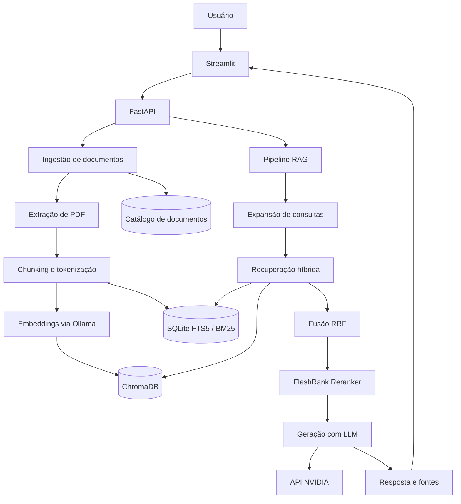
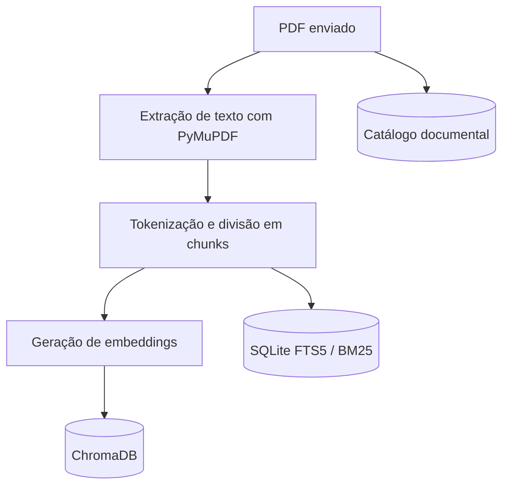
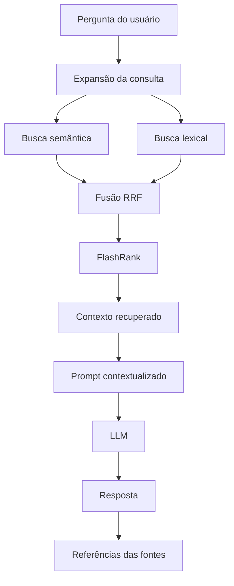

# ⚖️ RegTech Copilot RAG

**Assistente inteligente para consulta e análise de documentos regulatórios utilizando Large Language Models (LLMs), Retrieval-Augmented Generation (RAG) e recuperação híbrida de informações.**

O RegTech Copilot é uma aplicação que permite enviar documentos regulatórios em PDF, indexar seu conteúdo e realizar perguntas em linguagem natural. As respostas são geradas por um modelo de linguagem com apoio de trechos recuperados dos documentos, permitindo consultar as fontes utilizadas na resposta.

O projeto foi desenvolvido com foco em demonstrar, na prática, conceitos de Engenharia de IA, processamento de documentos, recuperação de informação, integração com LLMs e desenvolvimento de aplicações com Python.

---

## 📌 Visão geral

### O problema

Documentos regulatórios costumam ser extensos, técnicos e difíceis de consultar. Encontrar rapidamente uma informação específica exige conhecer a estrutura do documento, localizar artigos relevantes e interpretar diferentes trechos.

Além disso, utilizar um modelo de linguagem sem acesso a fontes confiáveis pode produzir respostas imprecisas ou informações inexistentes.

### A solução

O RegTech Copilot combina recuperação de informações e geração de linguagem natural para permitir consultas sobre documentos previamente indexados.

O usuário pode:

- Enviar documentos regulatórios em PDF.
- Consultar os documentos disponíveis no catálogo.
- Fazer perguntas em linguagem natural.
- Receber respostas contextualizadas pelos documentos.
- Visualizar as fontes utilizadas na geração da resposta.
- Gerenciar os documentos indexados.

### Proposta de valor

Transformar documentos regulatórios extensos em uma base consultável, combinando recuperação semântica, busca lexical e geração de respostas fundamentadas em fontes documentais.

---

## ✨ Funcionalidades

| Funcionalidade | Descrição |
|---|---|
| Upload de documentos | Envio de arquivos PDF para processamento |
| Extração de conteúdo | Leitura do conteúdo textual dos PDFs |
| Tokenização e chunking | Divisão do conteúdo em fragmentos menores |
| Geração de embeddings | Representação vetorial dos fragmentos |
| Indexação vetorial | Armazenamento no ChromaDB |
| Indexação lexical | Busca textual com SQLite FTS5 e BM25 |
| Recuperação híbrida | Combinação de resultados semânticos e lexicais |
| Expansão de consultas | Geração de variantes para ampliar a recuperação |
| Reranking | Reordenação dos resultados com FlashRank |
| Geração de respostas | Integração com modelos de linguagem |
| Referências documentais | Exibição dos trechos utilizados na resposta |
| Catálogo documental | Listagem, consulta e exclusão de documentos |

---

## 🏗️ Arquitetura

A aplicação utiliza uma arquitetura organizada por responsabilidades, separando interface, API, ingestão, recuperação, geração e armazenamento.

### Visão geral dos componentes


---

## 🛠️ Stack tecnológica e responsabilidades

| Componente | Tecnologia | Responsabilidade |
|---|---|---|
| Interface | Streamlit | Interação com o usuário |
| API | FastAPI | Exposição dos serviços |
| Linguagem | Python 3.12 | Implementação da aplicação |
| Gerenciamento de dependências | uv | Ambientes e dependências Python |
| Embeddings | Ollama / nomic-embed-text | Representação vetorial |
| LLM | NVIDIA API / Nemotron | Geração das respostas |
| Banco vetorial | ChromaDB | Armazenamento e busca semântica |
| Busca lexical | SQLite FTS5 / BM25 | Recuperação por correspondência textual |
| Fusão de resultados | Reciprocal Rank Fusion | Combinação dos rankings |
| Reranking | FlashRank | Reordenação dos resultados |
| Processamento de PDF | PyMuPDF | Extração do conteúdo |
| Tokenização | tiktoken | Contagem e divisão em tokens |
| Validação | Pydantic | Validação de dados e configurações |
| Cliente HTTP | HTTPX | Comunicação com serviços externos |
| Containers | Docker | Empacotamento da aplicação |
| Orquestração | Docker Compose | Execução dos serviços |
| Testes | pytest | Testes automatizados |
| Qualidade de código | Ruff | Lint e formatação |
| Análise estática | mypy | Verificação de tipos |

---

## 🔎 Como funciona o RAG

O projeto utiliza **Retrieval-Augmented Generation (RAG)**, uma arquitetura que combina recuperação de informações com geração de texto por modelos de linguagem.

Em vez de depender exclusivamente do conhecimento adquirido durante o treinamento do modelo, a aplicação recupera informações dos documentos indexados e utiliza esse conteúdo como contexto para gerar a resposta.

### 1. Ingestão e indexação



**Etapas:**

1. O usuário envia um documento PDF.
2. O conteúdo textual é extraído com PyMuPDF.
3. O texto é dividido em fragmentos menores, chamados *chunks*.
4. Cada fragmento é convertido em uma representação vetorial, chamada *embedding*.
5. Os embeddings são armazenados no ChromaDB.
6. O conteúdo também é indexado para recuperação lexical no SQLite FTS5.
7. Os metadados do documento são registrados no catálogo.

### 2. Recuperação e geração



**Etapas:**

1. O usuário envia uma pergunta.
2. A consulta pode ser expandida para ampliar as possibilidades de recuperação.
3. A busca semântica procura fragmentos com significado semelhante.
4. A busca lexical procura correspondências textuais.
5. Os resultados são combinados por Reciprocal Rank Fusion (RRF).
6. O FlashRank pode reordenar os resultados recuperados.
7. Os fragmentos selecionados são incorporados ao contexto do prompt.
8. O modelo de linguagem gera a resposta.
9. A aplicação retorna a resposta e as referências documentais utilizadas.

### Por que utilizar recuperação híbrida?

A busca semântica e a busca lexical possuem características complementares.

- **Busca semântica:** ajuda a encontrar conteúdos relacionados pelo significado, mesmo quando a pergunta utiliza palavras diferentes das presentes no documento.
- **Busca lexical:** favorece a localização de termos exatos, expressões técnicas, números e referências.
- **RRF:** combina os rankings das diferentes estratégias de recuperação.
- **FlashRank:** permite reordenar os resultados para priorizar os fragmentos mais relevantes.

A combinação dessas estratégias busca melhorar a qualidade do contexto entregue ao modelo de linguagem.

---

## 🧠 Conceitos de IA demonstrados

O projeto também funciona como uma implementação prática de conceitos fundamentais de aplicações modernas com LLMs.

<details>
<summary><strong>📚 Ver conceitos teóricos aplicados (Tokenização, Embeddings, Transformers e RAG)</strong></summary>
<br>

### Tokenização

Modelos de linguagem não processam diretamente palavras como unidades universais. O texto é convertido em tokens, que podem representar palavras, partes de palavras, pontuação ou outros elementos.

O projeto utiliza `tiktoken` para auxiliar na contagem e divisão do conteúdo em fragmentos.

**Configuração inicial:**

- Tamanho dos chunks: 700 tokens.
- Sobreposição: 100 tokens.

A sobreposição ajuda a preservar informações que poderiam ser separadas durante a divisão do texto.

### Embeddings

Embeddings são representações numéricas de conteúdos textuais em um espaço vetorial.

Trechos semanticamente relacionados tendem a apresentar maior proximidade nesse espaço, permitindo recuperar informações mesmo quando a pergunta não utiliza exatamente as mesmas palavras do documento.

O projeto utiliza o modelo `nomic-embed-text`, executado localmente por meio do Ollama.

### Transformers e LLMs

Transformers são uma arquitetura de redes neurais que utiliza mecanismos de atenção para processar relações entre elementos de uma sequência.

Modelos de linguagem baseados nessa arquitetura conseguem interpretar o contexto de uma entrada e gerar sequências de texto.

Neste projeto, o modelo Nemotron é utilizado para gerar respostas a partir das perguntas e do contexto recuperado.

### Prompt Engineering

A construção do prompt organiza a pergunta e o contexto recuperado para orientar o comportamento do modelo.

O objetivo é direcionar a geração para o conteúdo documental disponível e reduzir respostas sem fundamentação nas fontes consultadas.

### Retrieval-Augmented Generation

RAG conecta a recuperação de conhecimento externo à geração de linguagem natural.

Essa abordagem permite trabalhar com documentos específicos sem precisar realizar um novo treinamento do modelo a cada atualização da base documental.
</details>
---

## 📂 Estrutura do projeto

```text
regtech-copilot/
│
├── src/
│   └── regtech_copilot/
│       ├── api/
│       │   ├── routes/
│       │   │   ├── documents.py
│       │   │   ├── health.py
│       │   │   └── query.py
│       │   ├── dependencies.py
│       │   ├── lifespan.py
│       │   └── main.py
│       │
│       ├── core/
│       │   └── config.py
│       │
│       ├── documents/
│       │   └── catalog.py
│       │
│       ├── embeddings/
│       │   ├── base.py
│       │   ├── factory.py
│       │   └── ollama.py
│       │
│       ├── generation/
│       │   ├── prompt_builder.py
│       │   └── service.py
│       │
│       ├── ingestion/
│       │   ├── chunker.py
│       │   ├── pdf_loader.py
│       │   └── service.py
│       │
│       ├── llm/
│       │   ├── base.py
│       │   ├── factory.py
│       │   ├── nvidia.py
│       │   └── ollama.py
│       │
│       ├── retrieval/
│       │   ├── flashrank_reranker.py
│       │   ├── lexical_store.py
│       │   ├── query_expander.py
│       │   └── service.py
│       │
│       ├── schemas/
│       │   └── documents.py
│       │
│       ├── ui/
│       │   ├── api_client.py
│       │   └── app.py
│       │
│       └── vector_store/
│           ├── base.py
│           └── chroma.py
│
├── scripts/
│   └── benchmark_retrieval.py
│
├── tests/
│   ├── api/
│   ├── integration/
│   └── unit/
│
├── data/
│   ├── documents/
│   └── vector_store/
│
├── .env.example
├── .gitignore
├── .dockerignore
├── compose.yaml
├── Dockerfile
├── pyproject.toml
├── uv.lock
└── README.md
```

---

## 🚀 Executando localmente com Docker

### Pré-requisitos

- Docker Engine ou Docker Desktop.
- Docker Compose.
- Chave de API NVIDIA válida.
- Acesso à internet para baixar as imagens e o modelo de embeddings na primeira execução.

### 1. Clonar o repositório

```bash
git clone https://github.com/DevAugustomelo/regtech-copilot.git
cd regtech-copilot
```

### 2. Configurar as variáveis de ambiente

Crie o arquivo de configuração local:

```bash
cp .env.example .env
```

Edite o arquivo `.env` e configure sua chave NVIDIA:

```dotenv
LLM_PROVIDER=nvidia
LLM_BASE_URL=https://integrate.api.nvidia.com/v1
LLM_MODEL=nvidia/nemotron-3.5-lightning-30b-a3b
NVIDIA_API_KEY=sua_chave_nvidia

EMBEDDING_PROVIDER=ollama
EMBEDDING_BASE_URL=http://localhost:11434
EMBEDDING_MODEL=nomic-embed-text
```

O arquivo `.env` contém informações privadas e não deve ser enviado ao GitHub.

O Docker Compose configura internamente o endereço do Ollama para comunicação entre containers.

### 3. Construir e iniciar os serviços

```bash
docker compose up -d --build
```

O Docker Compose inicia:

| Serviço | Responsabilidade |
|---|---|
| `ollama` | Executa o serviço de embeddings |
| `ollama-init` | Baixa o modelo nomic-embed-text |
| `api` | Executa a API FastAPI |
| `ui` | Executa a interface Streamlit |

Na primeira inicialização, o download das imagens e do modelo pode levar alguns minutos.

### 4. Acessar a aplicação

| Recurso | Endereço |
|---|---|
| Interface Streamlit | http://localhost:8501 |
| API | http://localhost:8000 |
| Swagger / OpenAPI | http://localhost:8000/docs |
| Health check | http://localhost:8000/health |

### 5. Verificar os serviços

```bash
docker compose ps
```

**Consultar os logs:**

```bash
docker compose logs -f api
```

```bash
docker compose logs -f ui
```

```bash
docker compose logs -f ollama
```

### 6. Encerrar os serviços

```bash
docker compose down
```

Os volumes nomeados são preservados por esse comando.

> **Atenção:** não utilize `docker compose down -v` se desejar preservar os documentos, embeddings, índices e dados do Ollama. A opção `-v` remove os volumes associados ao Compose.

---

## 💻 Ambiente de desenvolvimento sem Docker

Também é possível executar a aplicação diretamente no ambiente Python.

### Pré-requisitos

- Python 3.12.
- `uv`.
- Ollama instalado e em execução.
- Modelo `nomic-embed-text` disponível no Ollama.
- Chave de API NVIDIA configurada.

### 1. Instalar as dependências

```bash
uv sync --dev
```

### 2. Baixar o modelo de embeddings

```bash
ollama pull nomic-embed-text
```

### 3. Configurar o ambiente

Configure o `.env` com os endereços locais dos serviços:

```dotenv
LLM_PROVIDER=nvidia
LLM_BASE_URL=https://integrate.api.nvidia.com/v1
LLM_MODEL=nvidia/nemotron-3.5-lightning-30b-a3b
NVIDIA_API_KEY=sua_chave_nvidia

EMBEDDING_PROVIDER=ollama
EMBEDDING_BASE_URL=http://localhost:11434
EMBEDDING_MODEL=nomic-embed-text
```

### 4. Iniciar a API

Em um terminal:

```bash
uv run uvicorn regtech_copilot.api.main:app --reload --host 0.0.0.0 --port 8000
```

### 5. Iniciar a interface

Em outro terminal:

```bash
uv run streamlit run src/regtech_copilot/ui/app.py
```

A interface estará disponível em:

http://localhost:8501

---

## 🖥️ Utilizando a aplicação

### Gerenciamento de documentos

Na interface Streamlit, o usuário pode:

1. Acessar a área de gerenciamento.
2. Selecionar um documento PDF.
3. Enviar o arquivo para processamento.
4. Acompanhar o resultado da ingestão.
5. Consultar os documentos registrados no catálogo.
6. Excluir documentos quando necessário.

O limite padrão de upload configurado é de 20 MB.

### Consultas regulatórias

Na área de consulta, o usuário pode escrever perguntas em linguagem natural sobre os documentos indexados.

**Exemplos:**

- Quais são os princípios previstos na LGPD?
- Quais são as hipóteses legais para o tratamento de dados pessoais?
- Quais são os direitos dos titulares?
- Quais responsabilidades cabem ao controlador e ao operador?
- Em quais situações os dados pessoais podem ser conservados?
- Quais requisitos são necessários para a transferência internacional de dados?

A aplicação apresenta a resposta e as fontes documentais utilizadas na recuperação.

> **Importante:** o RegTech Copilot é uma ferramenta de apoio à consulta e análise documental. Suas respostas devem ser verificadas nas fontes oficiais e não substituem orientação jurídica profissional.

---

## 🔌 API REST

A aplicação disponibiliza uma API desenvolvida com FastAPI.

### Endpoints

| Método | Endpoint | Descrição |
|---|---|---|
| `GET` | `/health` | Verifica a saúde da API |
| `POST` | `/query` | Realiza uma consulta RAG |
| `GET` | `/documents` | Lista documentos indexados |
| `GET` | `/documents/{document_id}` | Consulta detalhes de um documento |
| `POST` | `/documents` | Envia e processa um PDF |
| `DELETE` | `/documents/{document_id}` | Exclui um documento e seus registros |

### Exemplo de consulta

**Requisição:**

```http
POST /query
Content-Type: application/json
```

**Corpo:**

```json
{
  "query": "Quais são os princípios da LGPD?",
  "top_k": 5
}
```

O campo `top_k` é opcional. Quando não informado, a aplicação utiliza sua configuração padrão.

**A resposta contém:**

- `answer`: resposta gerada.
- `sources`: fontes utilizadas.
- `provider`: provedor do modelo.
- `model`: modelo utilizado.
- `input_tokens`: tokens de entrada, quando disponíveis.
- `output_tokens`: tokens de saída, quando disponíveis.

Cada fonte pode apresentar identificação, nome do arquivo, página, pontuação de recuperação e trecho textual.

### Upload de documentos

O endpoint `POST /documents` recebe um arquivo PDF por meio de `multipart/form-data` e executa o fluxo de ingestão.

### Documentação interativa

A documentação OpenAPI pode ser acessada em:

http://localhost:8000/docs

---

## 💾 Persistência de dados

O Docker Compose utiliza volumes nomeados para preservar os dados entre reinicializações dos containers.

| Volume | Conteúdo |
|---|---|
| `documents` | PDFs enviados e gerenciados pela aplicação |
| `vector_store` | Índice vetorial e banco lexical |
| `ollama_data` | Modelos e dados do Ollama |

A persistência permite reiniciar os serviços sem precisar realizar novamente a ingestão dos documentos.

---

## 🧪 Testes e avaliação

O projeto possui testes automatizados organizados por responsabilidade, incluindo testes unitários, de integração e da API.

### Executar os testes

```bash
uv run pytest
```

### Verificar a qualidade do código

```bash
uv run ruff check .
```

### Verificar a formatação

```bash
uv run ruff format --check .
```

### Executar a análise estática

```bash
uv run mypy src/regtech_copilot
```

---

## ⚠️ Limitações e considerações

- A qualidade das respostas depende da qualidade dos documentos e da recuperação dos trechos relevantes.
- PDFs digitalizados sem camada textual podem exigir OCR, funcionalidade que não faz parte do fluxo atual documentado.
- A geração de respostas depende da disponibilidade do provedor de LLM.
- O modelo pode interpretar incorretamente um trecho recuperado; as fontes devem ser conferidas.
- A aplicação ainda precisa de mecanismos adicionais de autenticação e autorização para uso público.
- O benchmark atual utiliza um conjunto delimitado de perguntas e artigos da LGPD; seus resultados não representam uma avaliação universal da qualidade do sistema.

---

## 🗺️ Roadmap

- [x] Estrutura inicial do projeto Python.
- [x] Integração com provedores de LLM.
- [x] Integração com Ollama para embeddings.
- [x] Extração e processamento de PDFs.
- [x] Tokenização e chunking.
- [x] Indexação vetorial com ChromaDB.
- [x] Recuperação lexical com SQLite FTS5 / BM25.
- [x] Recuperação híbrida com fusão RRF.
- [x] Expansão de consultas.
- [x] Reranking com FlashRank.
- [x] API com FastAPI.
- [x] Interface com Streamlit.
- [x] Catálogo e gerenciamento de documentos.
- [x] Persistência com Docker Compose.
- [x] Testes automatizados e benchmark de recuperação.
- [ ] Aprimorar a cobertura e a qualidade da recuperação.
- [ ] Melhorar a qualidade das respostas com base nos resultados do benchmark.
- [ ] Validar integralmente a implantação na AWS.
- [ ] Implementar autenticação e autorização.
- [ ] Ampliar os formatos documentais suportados.
- [ ] Expandir o conjunto de avaliação e os testes de qualidade das respostas.


---
